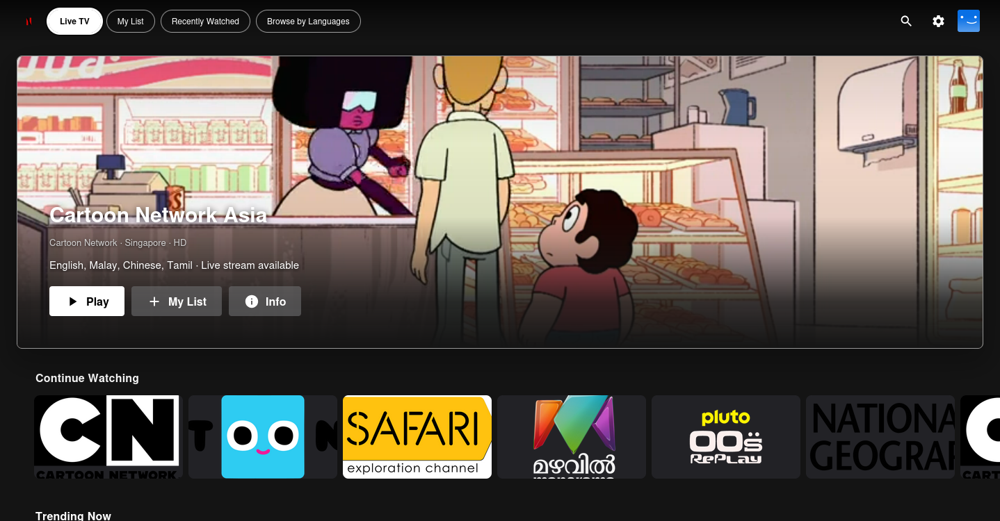

# AirWave TV

**AirWave TV** is a self-hosted live IPTV streaming web application. It turns a raw M3U playlist into an interactive Live TV experience — hero banner, instant channel preview, full channel grid, and HLS playback — served as a single-page app.

- **Local:** [http://localhost:8585](http://localhost:8585)

## Screenshots

### Home / Live TV experience



### Live TV grid


## Features

- Live TV channel catalog with instant hero-banner preview
- Full Live TV grid with rich metadata (logos, numbers, categories)
- Fast search with early-exit optimization
- HLS playback via hls.js with H.264/AAC playback fixes
- Lightweight single-page backend (Express) with status/health APIs

## Tech Stack

- **Runtime:** Node.js, Express, Socket.IO
- **Frontend:** Vanilla JS + HLS.js, custom CSS
- **Media:** HLS streams from M3U playlist
- **Packaging paths:** Electron → Windows EXE · Flask → PyInstaller EXE

## Getting Started

```bash
# install deps
npm install

# start server
npm start
```

Then open the Live Preview URL above in a browser.

---

*AirWave TV — live TV, beautifully simple.*
